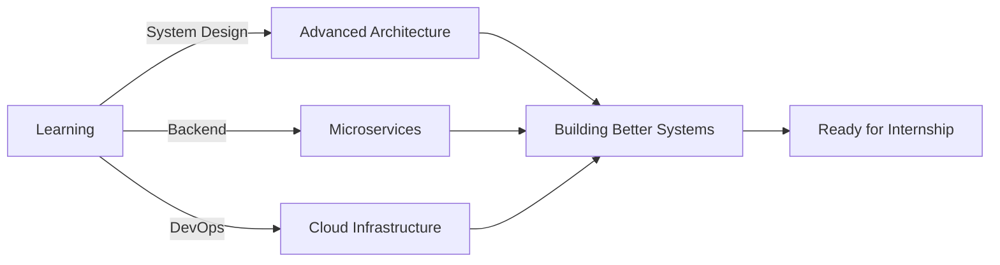

<div align="center">

<!-- Animated Header -->


<!-- Typing SVG -->
<a href="https://git.io/typing-svg">
  
</a>

<br/>

<!-- Badges -->
<p>
  
  
  
</p>

<br/>

```javascript
const sagar = {
    role: "Software Developer",
    education: "B.Tech Computer Science",
    focus: ["Mobile Development", "Full-Stack", "System Design"],
    achievements: ["SIH 2025 Winner 🏆", "INNOHACK Winner 🥇"],
    currentlyLearning: "Advanced System Architecture",
    lookingFor: "Internship Opportunities",
    motto: "Building systems that solve real problems"
};
```

</div>

---

## 🎯 Quick Highlights

<table>
<tr>
<td width="50%">

### 🏆 Achievements
- 🥇 **Smart India Hackathon Winner** (SIH 2025)
- 🥇 **INNOHACK 1st Prize**
- 💼 **Delivered Production Systems** as Freelancer
- 📱 **Multiple Published Apps** in Production

</td>
<td width="50%">

### 💪 Core Strengths
- ⚡ **Fast Learner** - Adapts quickly to new tech
- 🎨 **Clean Architecture** - Scalable, maintainable code
- 🚀 **End-to-End Development** - Idea to deployment
- 🔧 **Problem Solver** - Real-world impact focus

</td>
</tr>
</table>

---

## 🛠️ Technology Arsenal

<div align="center">

### 📱 Mobile Development
<p>
  
  
  
  
  
</p>

### 🌐 Web & Backend
<p>
  
  
  
  
  
</p>

### 🗄️ Database & Cloud
<p>
  
  
  
</p>

### ⚙️ Tools & DevOps
<p>
  
  
  
  
</p>

</div>

---

## 🚀 Featured Projects

<details open>
<summary><b>🔌 VeerGrid - Smart Microgrid System</b> <i>(SIH 2025 Winner)</i></summary>
<br/>

**Problem Solved:** Optimizing solar microgrid operations for efficiency and reliability

**Tech Stack:** `Flutter` `Node.js` `MongoDB` `IoT Integration` `Real-time Analytics`

**Key Features:**
- ⚡ Real-time monitoring of solar panels and battery systems
- 🧠 AI-powered load optimization algorithms
- 🔧 Automated fault detection and alerts
- 📊 Comprehensive analytics dashboard
- 🌐 Scalable architecture for multi-site deployment

**Impact:** Designed for real-world deployment in rural and industrial settings

</details>

<details>
<summary><b>🏭 FactorOn - Factory Management System</b></summary>
<br/>

**Problem Solved:** Streamlining factory operations and machine monitoring

**Tech Stack:** `Flutter` `Express.js` `MongoDB` `Role-based Access`

**Key Features:**
- 🏭 Real-time machine status monitoring
- 👥 Multi-role dashboard (Admin, Operator, Manager)
- 📈 Production analytics and reporting
- 🔔 Instant notifications for machine issues
- 📱 Cross-platform mobile and web access

**Impact:** Improved operational efficiency for manufacturing facilities

</details>

<details>
<summary><b>💬 Pictonion - Feedback Management Platform</b> <i>(Freelance Production)</i></summary>
<br/>

**Problem Solved:** Centralized customer feedback collection and analysis

**Tech Stack:** `React.js` `Node.js` `MongoDB` `JWT Authentication` `Analytics`

**Key Features:**
- 📝 Multi-channel feedback collection (QR, Web, Mobile)
- 🔐 Secure authentication with role-based permissions
- 📊 Advanced analytics and sentiment tracking
- 🎨 Customizable feedback forms
- 📱 Responsive design for all devices

**Impact:** Delivered production-ready system to paying client, handling thousands of feedback entries

</details>

<details>
<summary><b>📡 Bulky - Bulk Communication Service</b> <i>(Ongoing)</i></summary>
<br/>

**Problem Solved:** Scalable bulk email and task processing system

**Tech Stack:** `Node.js` `Bull Queue` `Redis` `Email APIs` `Microservices`

**Key Features:**
- 📧 High-volume email delivery with scheduling
- ⏰ Background job processing
- 🔄 Retry mechanisms and failure handling
- 📊 Delivery tracking and analytics
- 🔌 Extensible plugin architecture

**Impact:** Built to handle enterprise-scale communication needs

</details>

<details>
<summary><b>🏃 RunMate - Personal Running Tracker</b></summary>
<br/>

**Problem Solved:** Comprehensive running activity tracking and analysis

**Tech Stack:** `Android` `Kotlin` `Firebase` `Google Maps API` `MVVM`

**Key Features:**
- 📍 Real-time GPS tracking with route mapping
- ⏱️ Distance, speed, and time tracking
- 📊 Historical data and progress charts
- ☁️ Cloud sync across devices
- 🎯 Goal setting and achievement tracking

**Impact:** Published app with active users tracking their fitness journey

</details>

---

---

## 📊 GitHub Statistics

<div align="center">


</div>

## 🎓 What I Bring to the Table

<table>
<tr>
<td align="center" width="33%">

<h3>Fast Learner</h3>
<p>Quickly adapts to new technologies and frameworks. Thrives in dynamic environments.</p>
</td>
<td align="center" width="33%">

<h3>Clean Code</h3>
<p>Writes maintainable, scalable code following best practices and design patterns.</p>
</td>
<td align="center" width="33%">

<h3>Result-Driven</h3>
<p>Focuses on delivering practical solutions that create real-world impact.</p>
</td>
</tr>
</table>

---

## 🎯 Currently



---

## 📬 Let's Connect!

<div align="center">

### 💼 Open for Internship Opportunities

<p>
  <a href="mailto:aolkarsagar14@gmail.com">
    
  </a>
  <a href="https://linkedin.com/in/sagar-akolkar-improving-living-with-tech">
    
  </a>
  <a href="https://github.com/SagarAkolkar23">
    
  </a>
  <a href="https://x.com/Sagar_Akolkar_">
    
  </a>
</p>

<br/>

### 📧 **aolkarsagar14@gmail.com**

<br/>


</div>

---

<div align="center">

### 💡 Fun Fact

*"I don't just build apps — I build systems that solve real problems."*

<br/>

**⭐ Star my repositories if you find them interesting!**


</div>
